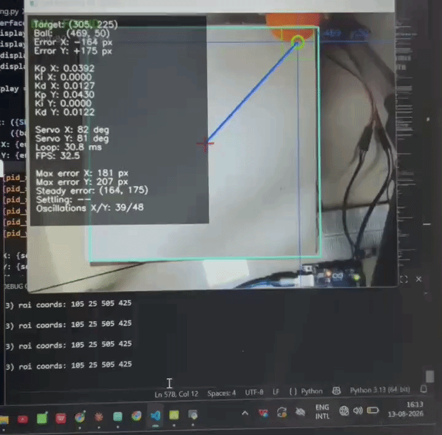
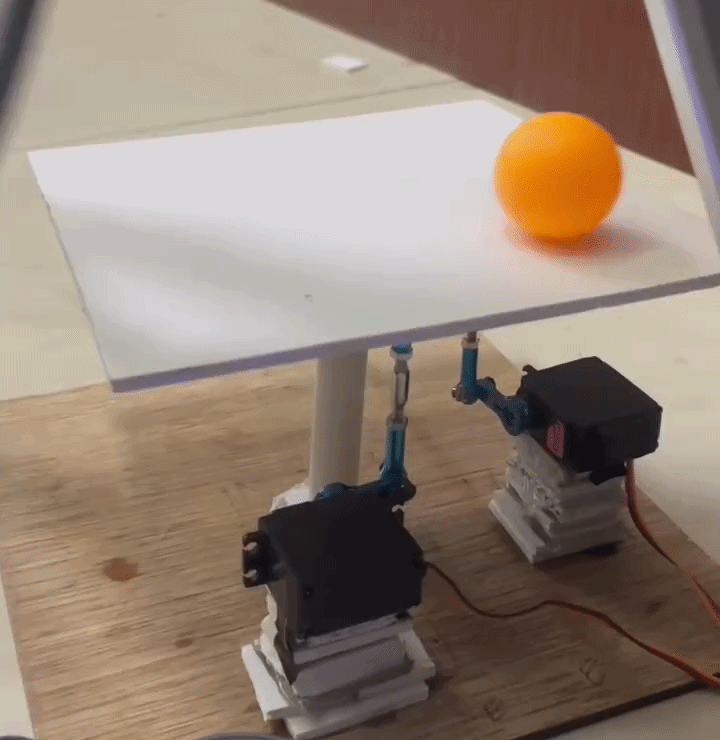
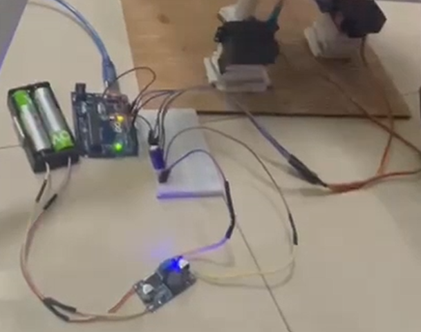

# Ball Balancing PID System

2-axis ball balancing platform using OpenCV + Arduino Uno.

---

## Attribution

Adapted from [giusenso/Ball-Balancing-PID-System](https://github.com/giusenso/Ball-Balancing-PID-System)
by Giuseppe Sensolini (MIT License).  
The original project is a C++/Linux implementation targeting ATmega2560.  
This project ports the core architecture to Python + OpenCV on Windows,
adapted for Arduino Uno with MG996R servos and DroidCam as the vision input.

---

## Directory Structure

```
ball_balancing/
├── main.py             # standard / debug / hsv modes
├── main_tuning.py      # tuning variant with live PID metrics overlay
├── ball_physic.py      # ball position + velocity tracking (ring buffer + moving avg filter)
├── ball_tracker.py     # OpenCV detection (HSV threshold, morphology, contour moments)
├── pid.py              # PI-D controller with anti-windup and rate limiter
├── config.json         # all tunable parameters (HSV, PID gains, servo limits, serial port)
├── README.md
└── arduino/
    └── ball_balancing.ino   # Arduino sketch — receives angles, drives servos
```

---

## Hardware

| Component | Notes |
|---|---|
| Arduino Uno | Serial receiver + servo driver |
| MG996R servo × 2 | X and Y axis |
| Android phone (DroidCam) | Overhead camera via USB |
| 2× 18650 cells + BMS | Servo power (7.4V) |
| LM2596 buck converter | 7.4V → 5V for servos |
| 100µF capacitor | Across buck output terminals |
| 25×25cm sunboard platform | Balancing surface |

**Wiring:**
- Servo X signal → Arduino pin 9
- Servo Y signal → Arduino pin 10
- Servo power (+) → external 5V from buck converter (NOT Arduino 5V pin)
- Common ground between external supply and Arduino GND — mandatory

---
## Demo



## Platform



## Wiring



---

## Setup

### 1. Install Python dependencies
```bash
pip install opencv-python pyserial numpy
```

### 2. Upload Arduino sketch
Open `arduino/ball_balancing.ino` in Arduino IDE and upload to Uno.

### 3. Configure `config.json`
- Set `serial_port` to your Arduino port (e.g. `COM5` on Windows)
- Set `camera_index` to match DroidCam (check with setup notebook)
- Set `center_x` and `center_y` to your mechanical servo centers

### 4. Tune HSV values
```bash
python main.py hsv
```
Adjust sliders until only the ball is white in the mask. Press **S** to save.

### 5. Run

**Standard mode** (clean loop):
```bash
python main.py
```

**Debug mode** (overlay + mask window):
```bash
python main.py debug
```

**Tuning mode** (live PID metrics: error, settling time, oscillation count):
```bash
python main_tuning.py debug
```

Press **Q** to quit any mode.

---

## PID Tuning

Edit gains in `config.json` and restart.

**Tuning order:**

1. **Kp only** (Ki=0, Kd=0)
2. **Add Kd** — at ~0.3× Kp.
3. **Ki** — only if ball settles consistently off-centre.

**Use `main_tuning.py`** to see live error, settling time, and oscillation count while tuning.

**Analyse offline with CSV:**  
Every run writes `pid_output_data.csv`. Plot `x_ball` vs `x_out` to visualise the response.

---

## Modes

| Command | Application |
|---|---|
| `python main.py` | Standard — clean control loop |
| `python main.py debug` | Overlay: ball box, velocity arrow, trail, PID output |
| `python main.py hsv` | HSV tuner — saves to config.json |
| `python main_tuning.py` | Tuning metrics: error, FPS, settling time, oscillations |
| `python main_tuning.py debug` | Tuning metrics + full debug overlay |
